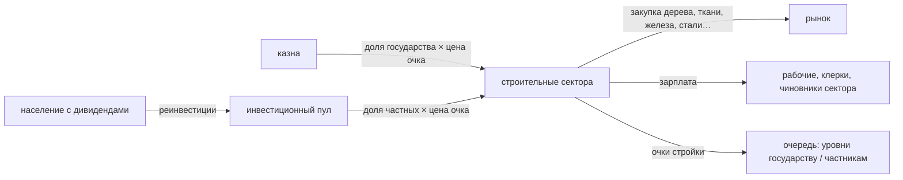

# Потоки стройки (ваниль)

## Суть

Стройка двигает деньги по трём рёбрам: **казна → стройка** (государственная очередь), **пул → стройка** (частная
очередь), **стройка → рынок** (сектора покупают материалы). Пул наполняют реинвестиции населения — это вход потока, а
не стройки. Механика — [[Стройка]].

| поток | от кого → кому | когда | как считается | заметка |
| --- | --- | --- | --- | --- |
| государственная стройка | казна → сектора | неделя | очки государственной доли × цена очка | [[Казна оплачивает стройку]] |
| частная стройка | пул → сектора | неделя | очки частной доли × цена очка | [[Пул оплачивает частную стройку]] |
| закупка материалов | сектора → рынок | неделя | входы метода × занятость × цена товара | [[Сектора покупают стройматериалы]] |

## Как увидеть

- **В игре:** бюджет — статья государственной стройки; панель стройки — очки, доля частных, очередь; панель
  рынка — спрос секторов на материалы.
- **В сейве:** запись страны — `investment_pool=`, `previous_building_group_investments`; здания — уровни и
  `building_ownership_manager` (навык `vic3-sandbox`, «Известное»); статьи бюджета — `weekly_budget` (`v3 save`).

## Не выяснено

Все три потока — по описанию игры и полям файлов; размеры не измерены (прогон ваниль без модов 1.15 ночью 12.11 не
сделан — этап ОБН, шаг 2). Когда прогон будет: новая игра за Швейцарию, 10 лет, автосейв раз в год — по каждому потоку
число в год у 3–5 стран и «сверено на <прогон>».
