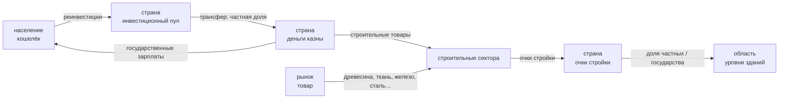

# Потоки стройки (ваниль)

## Суть

Стройка — семь потоков между пятью субъектами ([[Страна (субъект)|страна]], [[Область (субъект)|область]],
[[Строительные сектора (субъект)|строительные сектора]], [[Рынок (субъект)|рынок]],
[[Население (субъект)|население]]) по пяти счетам. Деньги идут не из пула в стройку, а через казну: казна платит за
всё, [[vanilla/Термины/Трансфер инвестиционного пула|трансфер пула]] возмещает ей частную долю. Механика —
[[Стройка]].

| поток | от → кому | счёт | когда | заметка |
| --- | --- | --- | --- | --- |
| очки | сектора → страна | [[Очки стройки (счёт)\|очки стройки]] | неделя | [[Сектора дают очки стройки]] |
| проекты | страна → область | очки стройки | неделя | [[Очки стройки уходят в проекты]] |
| товары — деньги | страна → сектора | [[Деньги казны (счёт)\|деньги казны]] | неделя | [[Казна оплачивает стройку]] |
| товары | рынок → сектора | [[Товар на рынке (счёт)\|товар на рынке]] | неделя | [[Сектора покупают стройматериалы]] |
| зарплата | страна → население | деньги казны | неделя | [[Казна платит зарплату строительных секторов]] |
| трансфер пула | пул → казна (страна) | [[Инвестиционный пул (счёт)\|инвестиционный пул]] | неделя | [[Пул оплачивает частную стройку]] |
| реинвестиции | население → страна | инвестиционный пул | неделя | [[Реинвестиции населения в пул]] |

## Как увидеть

- **В игре:** бюджет — «Строительные товары», «Государственные зарплаты», «Трансфер инвестиционного пула»; панель
  стройки — очки, доля частных, очередь; панель рынка — спрос секторов на материалы.
- **В сейве:** запись страны — `investment_pool=`, `previous_building_group_investments`; здания — уровни и
  `building_ownership_manager` (навык `vic3-sandbox`, «Известное»); бюджет — `v3 save`.

## Размеры — прогон

прогон src2 (ВМ, ваниль 1.15.2 без модов, новая игра SWI, 1836–1846, сейвы 1 января; `_tmp_analysis/runs/src2_y01…y07`); неделя в сейве 1 января, среднее за 10 лет:

| страна | строительные товары, £/нед. | трансфер пула, £/нед. | доля пула | зарплата секторов, £/нед. | реинвестиции в пул, £/нед. | уровни секторов 1837 → 1846 |
| --- | --- | --- | --- | --- | --- | --- |
| GBR | 132 419 | 101 991 | 0,77 | 4 410 | 118 875 | 46 → 57 |
| FRA | 40 762 | 33 379 | 0,82 | 1 920 | 40 498 | 25 → 27 |
| USA | 50 432 | 39 218 | 0,78 | 2 017 | 38 515 | 22 → 21 |
| RUS | 39 233 | 13 405 | 0,34 | 1 143 | 24 030 | 17 → 22 |
| PRU | 36 321 | 15 499 | 0,43 | 2 679 | 24 098 | 20 → 33 |

Главное из прогона: пул платит долю товаров по очкам, ушедшим в частные проекты (не по закону напрямую); пустая
очередь отдаёт очки другой; без проектов сектора товаров не берут, но получают зарплату. Сейв — поля в заметках
потоков; сборщик — `_tmp_analysis/runs/src2_collect.py`.
