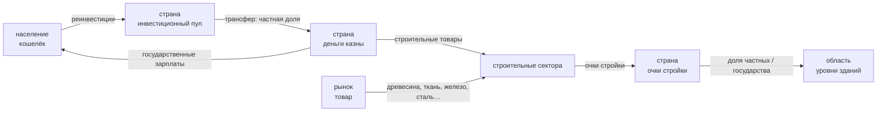

# Потоки стройки (ваниль)

## Суть

Стройка — семь потоков между пятью субъектами ([[Страна (субъект)|страна]], [[Область (субъект)|область]],
[[Строительные сектора (субъект)|строительные сектора]], [[Рынок (субъект)|рынок]],
[[Население (субъект)|население]]) по пяти счетам. Деньги идут не из пула в стройку, а через казну: казна платит за
всё, [[vanilla/Термины/Трансфер инвестиционного пула|трансфер пула]] возмещает ей частную долю. Механика —
[[Стройка]].

| поток | от → кому | счёт | когда | заметка |
| --- | --- | --- | --- | --- |
| очки | сектора → страна | [[Очки стройки (счёт)\|очки стройки]] | неделя | [[Сектора дают очки стройки]] |
| проекты | страна → область | очки стройки | неделя | [[Очки стройки уходят в проекты]] |
| товары — деньги | страна → сектора | [[Деньги казны (счёт)\|деньги казны]] | неделя | [[Казна оплачивает стройку]] |
| товары | рынок → сектора | [[Товар на рынке (счёт)\|товар на рынке]] | неделя | [[Сектора покупают стройматериалы]] |
| зарплата | страна → население | деньги казны | неделя | [[Казна платит зарплату строительных секторов]] |
| трансфер пула | пул → казна (страна) | [[Инвестиционный пул (счёт)\|инвестиционный пул]] | неделя | [[Пул оплачивает частную стройку]] |
| реинвестиции | население → страна | инвестиционный пул | неделя | [[Реинвестиции населения в пул]] |

## Как увидеть

- **В игре:** бюджет — «Строительные товары», «Государственные зарплаты», «Трансфер инвестиционного пула»; панель
  стройки — очки, доля частных, очередь; панель рынка — спрос секторов на материалы.
- **В сейве:** запись страны — `investment_pool=`, `previous_building_group_investments`; здания — уровни и
  `building_ownership_manager` (навык `vic3-sandbox`, «Известное»); бюджет — `v3 save`.

## Не выяснено

Размеры всех потоков — прогон [[SRC-2 — Прогон пилота «стройка» на ваниль 1.15|SRC-2]]: новая игра за Швейцарию,
10 лет, автосейв раз в год — по каждому потоку число в год у 3–5 стран и «сверено на <прогон>».
